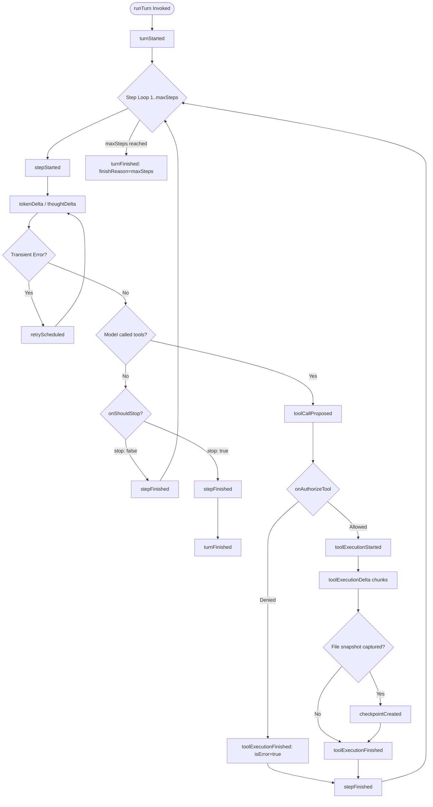

# Outward Streaming Event Catalog Specification

This document specifies the schema, discriminated union, serialization guarantees, and lifecycle emission sequence of all outward streaming events in `@amaranthic/hernex`.

The stream output of [`AgentEngine.runTurn`](file:///home/nolan/works/harnex/src/engine/AgentEngine.ts#L439-L468) is an `AsyncGenerator<AgentEvent, void, void>`.

All events conform to the [`AgentEvent`](file:///home/nolan/works/harnex/src/events/index.ts#L75-L88) discriminated union:

```typescript
export type AgentEvent =
  | TurnStartedEvent
  | StepStartedEvent
  | TokenDeltaEvent
  | ThoughtDeltaEvent
  | ToolCallProposedEvent
  | ToolExecutionStartedEvent
  | ToolExecutionDeltaEvent
  | CheckpointCreatedEvent
  | ToolExecutionFinishedEvent
  | StepFinishedEvent
  | TurnFinishedEvent
  | RetryScheduledEvent
  | ErrorEvent;
```

---

## 1. Serialization Guarantees

> [!IMPORTANT]
> **Pure Serializable JSON Objects**
> Every `AgentEvent` object is guaranteed to be a plain serializable JSON data structure. No events contain callbacks, function closures, or circular references. All fields are primitive values, read-only arrays, or plain nested objects.

---

## 2. Event Catalog & Schemas

### 2.1 Turn Lifecycle Events

#### `turnStarted`
Emitted at the initiation of an autonomous turn before input processing or model generation begins.

```typescript
export interface TurnStartedEvent {
  readonly type: "turnStarted";
  readonly turnIndex: number;
  readonly userMessage: string;
}
```

#### `turnFinished`
Emitted at the conclusion of an autonomous turn, providing the final termination reason and cumulative token usage across all executed steps.

```typescript
export interface TurnFinishedEvent {
  readonly type: "turnFinished";
  readonly turnIndex: number;
  readonly finishReason: TurnFinishReason;
  readonly totalUsage: StepTokenUsage;
}

export type TurnFinishReason =
  | "completed"
  | "maxSteps"
  | "maxTurns"
  | "interrupted"
  | "error"
  | "vetoed"
  | "lengthExceeded"
  | "contentFilter";

export interface StepTokenUsage {
  readonly promptTokens: number;
  readonly completionTokens: number;
  readonly totalTokens: number;
  readonly reasoningTokens?: number;
}
```

---

### 2.2 Step Lifecycle Events

#### `stepStarted`
Emitted at the commencement of each autonomous step iteration within the multi-step turn loop.

```typescript
export interface StepStartedEvent {
  readonly type: "stepStarted";
  readonly stepIndex: number;
  readonly timestamp: number;
}
```

#### `stepFinished`
Emitted when a step's generation and all associated tool executions complete.

```typescript
export interface StepFinishedEvent {
  readonly type: "stepFinished";
  readonly stepIndex: number;
  readonly usage?: StepTokenUsage;
}
```

---

### 2.3 Model Streaming Events

#### `tokenDelta`
Emitted incrementally as textual response tokens stream from the model provider.

```typescript
export interface TokenDeltaEvent {
  readonly type: "tokenDelta";
  readonly text: string;
  readonly messageId?: string;
}
```

#### `thoughtDelta`
Emitted incrementally when extended thinking or reasoning tokens stream from reasoning models (e.g. OpenAI o-series, Claude 3.7 Sonnet thinking mode).

```typescript
export interface ThoughtDeltaEvent {
  readonly type: "thoughtDelta";
  readonly text: string;
  readonly messageId?: string;
}
```

---

### 2.4 Tool Execution Events

#### `toolCallProposed`
Emitted as soon as the model yields a complete tool call with parsed parameters.

```typescript
export interface ToolCallProposedEvent {
  readonly type: "toolCallProposed";
  readonly callId: string;
  readonly toolName: string;
  readonly parameters: unknown;
}
```

#### `toolExecutionStarted`
Emitted immediately before an authorized tool begins execution on the host machine.

```typescript
export interface ToolExecutionStartedEvent {
  readonly type: "toolExecutionStarted";
  readonly callId: string;
  readonly toolName: string;
  readonly timestamp: number;
}
```

#### `toolExecutionDelta`
Emitted when a tool produces incremental streaming output (e.g. standard output chunks during shell execution).

```typescript
export interface ToolExecutionDeltaEvent {
  readonly type: "toolExecutionDelta";
  readonly callId: string;
  readonly toolName: string;
  readonly chunk: string;
}
```

#### `toolExecutionFinished`
Emitted when tool execution terminates, recording the result, execution duration, and error status.

```typescript
export interface ToolExecutionFinishedEvent {
  readonly type: "toolExecutionFinished";
  readonly callId: string;
  readonly toolName: string;
  readonly result: unknown;
  readonly isError: boolean;
  readonly durationMs: number;
}
```

---

### 2.5 State & Checkpoint Events

#### `checkpointCreated`
Emitted when a tool or engine operation captures a content-addressed snapshot of modified workspace files.

```typescript
export interface CheckpointCreatedEvent {
  readonly type: "checkpointCreated";
  readonly checkpointId: string;
  readonly sequence: number;
  readonly label: string;
  readonly filesTouched: readonly string[];
}
```

---

### 2.6 Resilience & Error Events

#### `retryScheduled`
Emitted when an upstream provider error (HTTP 429 rate limit, 503 gateway unavailable, or network drop) triggers an exponential backoff delay before retrying.

```typescript
export interface RetryScheduledEvent {
  readonly type: "retryScheduled";
  readonly attempt: number;
  readonly maxRetries: number;
  readonly delayMs: number;
  readonly error: Error;
}
```

#### `error`
Emitted when an unhandled exception occurs during turn execution.

```typescript
export interface ErrorEvent {
  readonly type: "error";
  readonly error: Error;
  readonly origin: ErrorOrigin;
  readonly toolName?: string;
  readonly isFatal: boolean;
}

export type ErrorOrigin = "model" | "tool" | "checkpoint" | "permission" | "engine";
```

---

## 3. Emission Sequence

The following diagram illustrates the emission order of events across a single turn:


